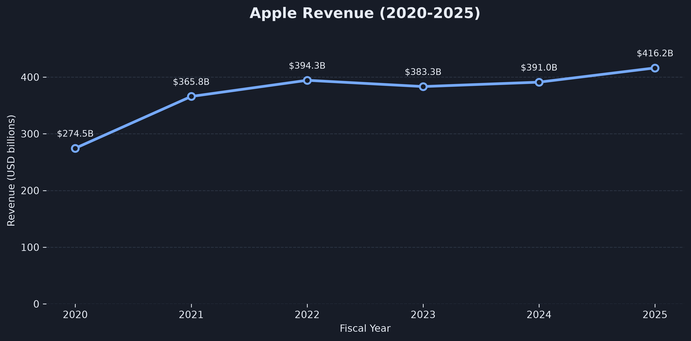
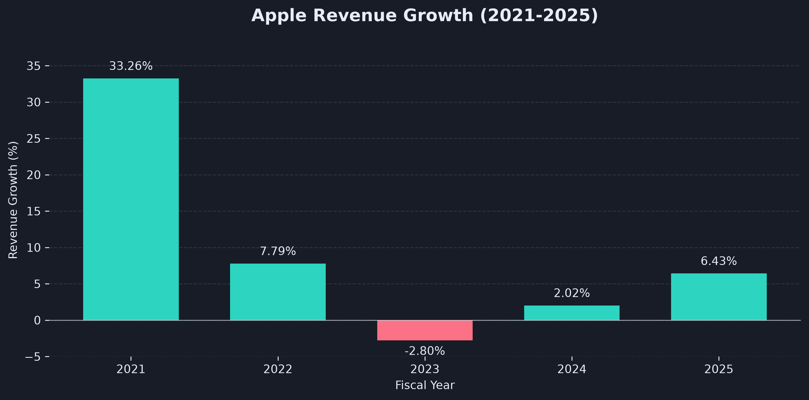
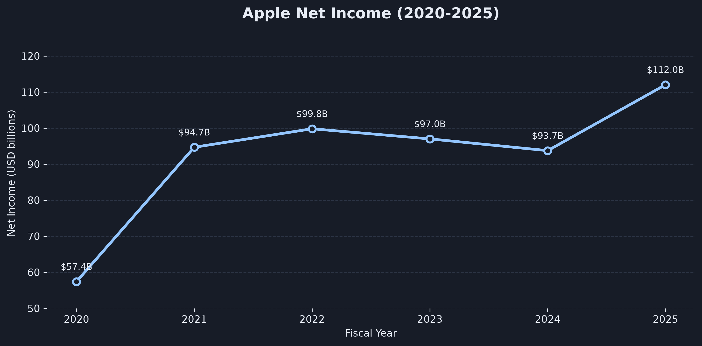
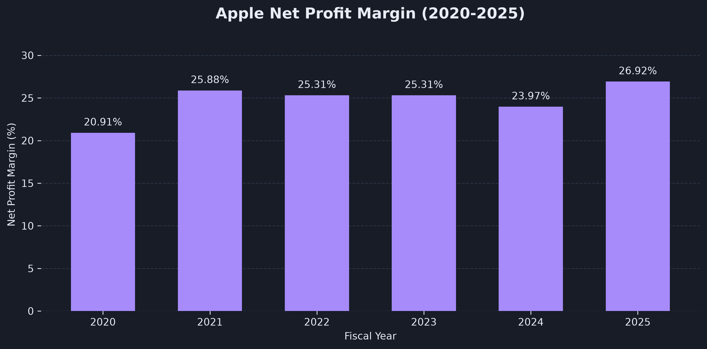

# Apple Financial Analysis (2020-2025)

## About the Project

I used Python to analyze Apple's financial results from 2020 to 2025, focusing on revenue, net income, and profit margins.

The data comes directly from the SEC EDGAR API. I wanted to practice working with real financial data, from retrieving and cleaning it to calculating financial metrics and creating visualizations.

## Tools Used

- Python (Pandas, Matplotlib, Requests)
- Jupyter Notebook
- SEC EDGAR API
- Excel

## Data

I collected Apple's annual revenue and net income figures from SEC filings.

Since the API includes historical figures reported in multiple filings, I checked the reporting periods and original 10-K reports to make sure each value was assigned to the correct fiscal year.

Data source: [SEC EDGAR - Apple Inc.](https://data.sec.gov/api/xbrl/companyfacts/CIK0000320193.json)

## Analysis

I calculated and visualized:

- Annual revenue and year-over-year growth
- Annual net income
- Net profit margin
- Changes in financial performance over time

I also checked the dataset for missing values, duplicate years, and inconsistencies.

## Results

| Metric | 2020 | 2025 |
|---|---:|---:|
| Revenue | $274.52B | $416.16B |
| Net Income | $57.41B | $112.01B |
| Net Profit Margin | 20.91% | 26.92% |

### Revenue

### Revenue Growth

### Net Income

### Net Profit Margin

A few things stood out:

- Revenue grew by approximately 51.6% between 2020 and 2025.
- The biggest year-over-year increase was in 2021 (+33.26%).
- Revenue fell slightly in 2023 (-2.80%) before growing again.
- Net income reached $112.01B in 2025, the highest value in the analyzed period.
- Net profit margin increased from 20.91% to 26.92%.

## Project Files

- `financial_analysis.ipynb` - Python code and analysis
- `data/` - processed financial data in CSV and Excel formats
- `charts/` - financial charts

## What I Learned

Working with the SEC API showed me why checking reporting periods matters, especially when the same financial figures appear in several annual filings.

It was also good practice in using Pandas to organize financial data and Matplotlib to present the results.